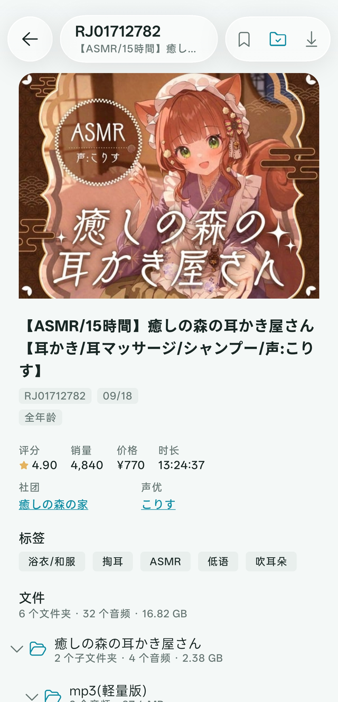
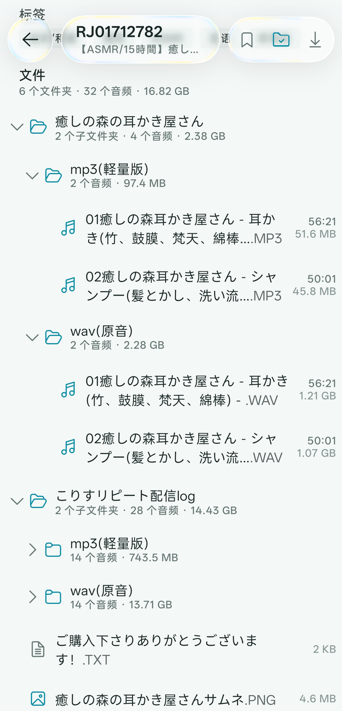
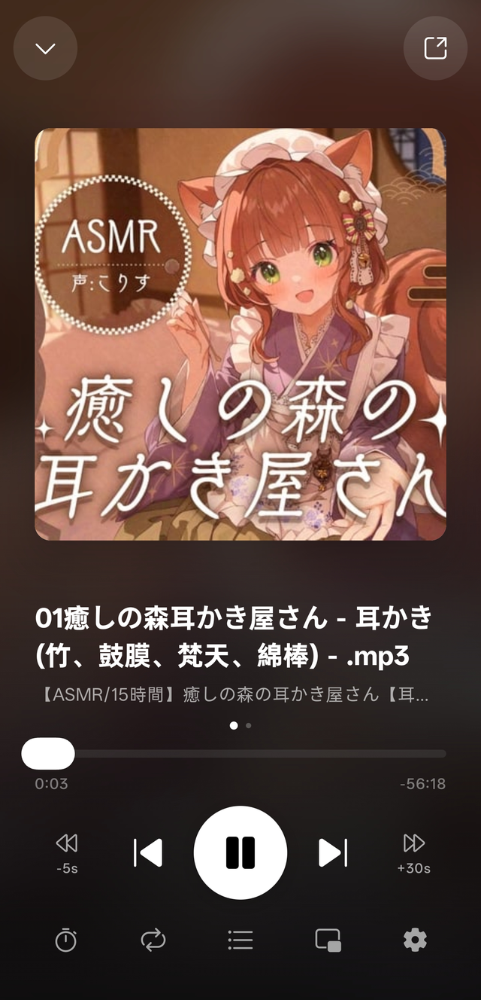
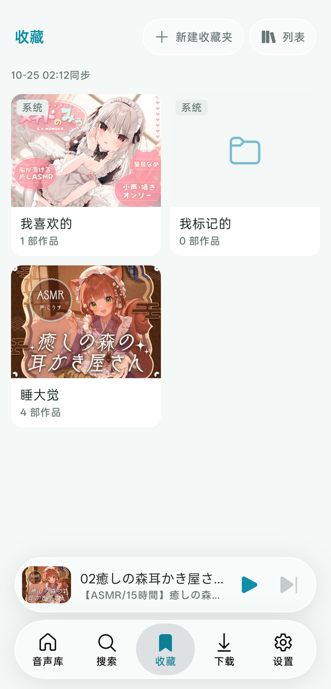

<p align="center">
  
  
  
  
</p>

<p align="center">
  <sub>作品详情 · 文件树 · 播放器 · 收藏</sub>
</p>

# ToAsmr

面向 **asmr.one / Kikoeru 兼容服务端** 的 Android 客户端，Kotlin + Jetpack Compose 编写，界面走「扁平分组 + 液态玻璃」的风格。

不是官方客户端。App 本体不含、也不托管任何音频：所有内容都来自你自己配置的服务器。

| | |
|---|---|
| 包名 | `com.asmrone.app` |
| 版本 | 0.5.3 |
| 最低系统 | Android 9（API 28） |
| 目标系统 | Android 16（API 36） |

---

## 功能

### 浏览与搜索

- 首页三个板块：所有内容 / 热门 / 推荐，滚动到底自动续页
- 关键词检索，标签 / 声优 / 社团可以叠成多条件
- 标签、声优、社团各有一份本地索引，点名字直接进「这一项的作品」列表
- 搜索框里直接输 RJ 号（`RJ01700554`、`rj1700554`、`1700554` 都认）→ 不搜索、直接打开那部作品
- 外部链接直达作品：`https://asmr.one/work/RJ01700554` 或 `toasmr://work/RJ01700554`

### 作品详情

- 封面、元数据、标签墙、社团与声优；点名字跳到对应资源
- 完整文件树，按文件夹展开/收起，**记住每部作品上次展开到哪**
- 音轨单击即播，队列限定在**同一文件夹**内并自动排除视频
- 视频走 Media3 播放；图片与文本可在应用内查看
- 长按标题选择文字，长按 RJ 号复制
- 文件名两行显示，第二行末尾固定给出真实格式（`…MP3`、`…WAV`），长名字不会把扩展名吃掉

### 播放

- 平台 `MediaPlayer` 内核 + `MediaSession`：通知栏、锁屏、耳机按键都能控制
- 音频焦点处理；来电或其它 App 抢占时暂停，恢复时自动续播
- 后台播放（前台服务）；可选「后台保护」一键跳到系统的电池优化白名单
- 播放速度 `0.5× – 2.0×`，变速不变调
- 播放模式：列表循环 / 单曲 / 随机
- 睡眠定时 `1 – 120` 分钟，可勾「等这一首放完再停」，停止前 6 秒渐弱
- 暂停时淡出（约 0.4 秒），不再是一刀切
- 上下曲两侧的 `-5s` / `+30s` 快捷跳转
- 歌词：同名的 `.lrc / .vtt / .srt / .ass / .ssa`（放在哪个文件夹都行）或**音频内嵌歌词**（ID3 `USLT`/`SYLT`、FLAC `VORBIS_COMMENT`），逐行高亮并跟随滚动
- 桌面歌词：把歌词开成悬浮窗，切到别的 App 也能看（需授予「显示在其他应用上层」）

### 收藏与同步

- 标记（状态 + 评分）与收藏夹，与云端同步
- 本地先写、失败进待补写队列，下次联网自动补
- 状态与评分可以**只清其中一项**：清空状态保留评分，或反过来
- 收藏夹可新建、删除，可从作品里直接勾选加入/移出

### 离线

- 两种落点，按需切换：
  - **App 内**：私有目录，App 里能看进度、能删
  - **本地文件夹**：默认 `/storage/emulated/0/ToAsmr/`，在文件管理器里就是一堆普通音频与清单（`.toasmr.json`），App 不管删除
- 在文件树里挑要下载的内容（文件夹支持三态勾选），断点续传，进度与内容都在「下载」页
- 已下载的作品再打开时，元数据与文件树直接读本地 —— **断网也能看、能播**
- 本地文件夹里已经有的文件不会重复下载

### 外观与数据

- 14 套主题色、跟随系统 / 亮暗色两个开关
- 液态玻璃（Backdrop）顶栏、底栏与迷你播放器
- 缓存按类型统计与清理、下载目录选择（系统文件夹选择器）、搜索索引更新、网络日志

---

## 构建

需要 Android Studio（AGP 9.2.1 / Gradle 9.4.1）、JDK 17 或更高、Android SDK 36。

```bash
git clone https://github.com/Minazuki-Hotaru1/ToAsmr.git
cd ToAsmr
./gradlew :app:assembleDebug
```

产物在 `app/build/outputs/apk/debug/app-debug.apk`。

正式包（R8 压缩 + 资源收缩）用 `:app:assembleRelease`。签名走环境变量，**密钥不进仓库**：

```
ASMRONE_KEYSTORE           密钥文件绝对路径（.jks / .keystore）
ASMRONE_KEYSTORE_PASSWORD  仓库口令
ASMRONE_KEY_ALIAS          密钥别名
ASMRONE_KEY_PASSWORD       密钥口令
```

不设置这四个变量时会退回 debug 签名 —— 能装能跑，但**不能发布**。

---

## 技术栈

| 用途 | 选型 |
|---|---|
| 语言 / UI | Kotlin 2.2 + Jetpack Compose（BOM 2026.02），Material 3 |
| 异步 | Kotlin Coroutines + StateFlow |
| 导航 | Navigation Compose |
| 音频 | 平台 `MediaPlayer` + `MediaSession` + 前台服务 + `AudioFocusRequest` |
| 视频 | Media3 / ExoPlayer |
| 图片 | Coil 2.6 |
| 玻璃效果 | Backdrop、kyant-shapes |
| 网络 | 平台 `HttpURLConnection` + `org.json`（**无第三方网络库**） |

网络层刻意没有引入 Retrofit/OkHttp：只有一个服务端、几十个固定端点，手写一层足够，也让离线缓存、ETag、`Range` 续传这些行为更容易控制。

---

## 权限说明

| 权限 | 用途 | 是否必需 |
|---|---|---|
| `INTERNET` / `ACCESS_NETWORK_STATE` | 访问你配置的服务器 | 是 |
| `WAKE_LOCK` / `FOREGROUND_SERVICE` / `FOREGROUND_SERVICE_MEDIA_PLAYBACK` | 后台播放与通知栏控制 | 是 |
| `POST_NOTIFICATIONS` | 播放控制通知（Android 13+） | 建议 |
| `MANAGE_EXTERNAL_STORAGE`（或旧系统的 `WRITE_EXTERNAL_STORAGE`） | 把下载存到公共目录 `ToAsmr/` | 可选 |
| `SYSTEM_ALERT_WINDOW` | 桌面歌词悬浮窗 | 可选 |
| `REQUEST_IGNORE_BATTERY_OPTIMIZATIONS` | 「后台保护」一键跳转 | 可选 |

不授予存储权限也能用：下载默认落在 App 私有目录里。只有选择「本地文件夹」时才需要它。

> `MANAGE_EXTERNAL_STORAGE` 属于敏感权限，Google Play 对它有严格限制。本项目不上架 Play，只以侧载方式分发。

---

## 已知限制

- 只支持 asmr.one / Kikoeru 兼容 API（内置 4 个预设主机，也可填自定义地址）
- 内嵌歌词只读 `mp3` 与 `flac`；M4A 的 `©lyr`、OGG/Opus 的注释头暂不支持
- 收藏与评分需要登录；未登录也能浏览、搜索与试听
- 仅 Android，没有 iOS / 桌面端

---

## 免责声明

- 本项目仅供学习与个人使用，**不提供、不存储、不分发任何音频内容**。
- 所有内容都来自你自己配置的服务器，请自行确认其合法性与站点条款。
- 与 asmr.one、DLsite 及其它内容平台**没有任何隶属关系**，也未获得其背书。

---

## 致谢

- [asmr.one](https://asmr.one) 与 Kikoeru 社区 —— 接口与生态
- [kyant0](https://github.com/kyant0) —— Backdrop、kyant-shapes
- Microsoft Fluent System Icons（MIT）
- Jetpack Compose、Media3、Coil
